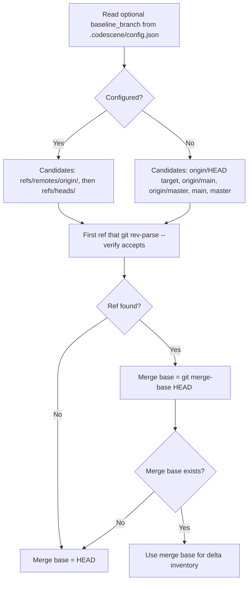

# Code Health Monitor baseline resolution

Since extension **0.29.0**, the bundled CodeScene CLI chooses the analysis baseline for each Git repository. The VS Code extension does not pass a `baseline-revision`; the CLI resolves it when watching the repository.

## What the baseline is

The Code Health Monitor compares each file against its content at a **merge base** commit. A file appears in the Monitor when it differs from that commit, or when it is untracked (and not ignored by Git). Uncommitted edits count: the working tree is compared to the merge base, not only new commits.

## How the baseline is selected



Steps in order:

1. Build a list of **candidate refs** from configuration, or use the default list below.
2. Pick the **first** candidate that `git rev-parse --verify <ref>^{commit}` accepts. Only refs already present in the local clone are used; the CLI does not run `git fetch`.
3. Let **HEAD** be the current commit. The baseline commit is `git merge-base HEAD <chosen-ref>`.
4. If no candidate ref exists, or merge-base returns nothing (no shared history), the baseline commit is **HEAD**.

**Default candidates** (when `baseline_branch` is not set), in order:

| Order | Ref |
|------|-----|
| 1 | Target of `refs/remotes/origin/HEAD` (only if that symbolic ref resolves) |
| 2 | `refs/remotes/origin/main` |
| 3 | `refs/remotes/origin/master` |
| 4 | `refs/heads/main` |
| 5 | `refs/heads/master` |

Duplicate entries are removed. A dangling `origin/HEAD` is skipped; the list continues with `origin/main`, and so on.

## Configuring the baseline

Set **`baseline_branch`** in `.codescene/config.json` to a **branch name** (not `origin/develop`, a tag, or a commit SHA):

```json
{
  "baseline_branch": "develop"
}
```

When configured:

- Candidates are only `refs/remotes/origin/<branch>` then `refs/heads/<branch>`. The remote-tracking ref wins if both exist.
- The value is used as-is (no trimming). A name with leading or trailing spaces is treated literally.
- The default candidate list is **not** used. If the branch cannot be resolved, the CLI does **not** fall back to `main` or `master`.

**Error messages** (logged at error level; analysis still runs using HEAD as the merge base):

- Branch missing:

  `Configured baseline branch missing could not be resolved as any of ["refs/remotes/origin/missing" "refs/heads/missing"] and analysis will fall back to HEAD.`

- Branch exists but shares no history with HEAD:

  `Configured baseline branch unrelated resolved as refs/heads/unrelated but has no merge base with HEAD; analysis will fall back to HEAD.`

Invalid JSON in `config.json` is ignored and the default candidate list is used.

## Fallbacks and edge cases

| Situation | Merge base used | Typical Monitor effect |
|-----------|-----------------|-------------------------|
| No candidate ref resolves | HEAD | Only uncommitted or untracked changes vs the current commit |
| Candidate ref has no merge base with HEAD | HEAD | Same as above |
| Repository has **no commits** | *(none)* | All tracked and untracked scorable files are included |
| Configured branch missing or unrelated | HEAD | Error logged; see messages above |

Only the **`origin`** remote is considered (`refs/remotes/origin/...`). Other remotes (for example `upstream`) are not part of the default list.

Tags do not participate in baseline selection.

## Examples

### Feature branch with `origin` and `main`

- **Setup:** `origin/main` at commit A; local `feature` branched from A with commit B; working tree clean.
- **Chosen ref:** `refs/remotes/origin/main` (or `origin/HEAD` if it points at `main`).
- **Merge base:** A.
- **Monitor:** Files changed in commit B (for example `feature.js`).

### Local `main` ahead of `origin/main`

- **Setup:** `origin/main` at A; local `main` has extra commit C; you work on `feature` from C.
- **Chosen ref:** `refs/remotes/origin/main` (not local `main`).
- **Merge base:** A (not C).
- **Monitor:** Files introduced on local `main` since the remote (C) **and** feature work, because both are after the merge base with `origin/main`.

### On default branch with unpushed commits

- **Setup:** Checked out `main`, one commit ahead of `origin/main`, clean tree.
- **Chosen ref:** `refs/remotes/origin/main`.
- **Merge base:** Tip of `origin/main`, not your local `HEAD`.
- **Monitor:** Files touched in the unpushed commit(s).

### `develop`-based workflow

- **Without config:** Default list looks for `main` / `master`, not `develop`. If only `develop` exists locally, no candidate matches and merge base becomes **HEAD** — committed work on `feature` may not appear in the Monitor.
- **With `"baseline_branch": "develop"`:** Candidates are `origin/develop` then `develop`; merge base is the branch point with `develop`.

### Local repository, no remote

- **Setup:** Only local `main` and `feature`.
- **Chosen ref:** `refs/heads/main`.
- **Monitor:** Files on `feature` not in `main`.

If the default branch is only `develop` (no `main` / `master`), unconfigured mode falls back to **HEAD**; set `baseline_branch` to `develop`.

### Dangling `origin/HEAD`

- **Setup:** `origin/HEAD` points at a missing ref; `origin/main` exists.
- **Chosen ref:** `refs/remotes/origin/main`.
- **Monitor:** Same as a normal `origin/main` baseline.

### Detached HEAD

- **Setup:** `git checkout` a specific commit (no branch name).
- **Behavior:** Baseline selection still uses the candidate refs above; `git merge-base` uses the detached **HEAD** commit. The Monitor keeps working; inventory depends on how HEAD relates to the chosen ref.

### Fork with default branch on `upstream`

- **Setup:** Your clone only has `origin` (your fork); the real default branch is on `upstream/main`.
- **Unconfigured:** Only `origin/*` and local `main` / `master` are considered. If your fork’s `origin/main` is stale, refresh it with `git fetch origin` or set `baseline_branch` explicitly.

### Orphan branch or no main-like branch

- **Setup:** Only branches like `develop` / `feature`, no `main`, `master`, or matching `origin/*` refs.
- **Merge base:** HEAD.
- **Monitor:** Committed files that match HEAD are omitted; uncommitted/untracked changes still appear.

## Changes since 0.28.x

- Baseline selection moved from the extension (`getMergeBaseCommit` in `git-utils.ts`) into the bundled CLI (`meta_data.clj`).
- For a configured branch, **`origin/<branch>` is preferred** over the local branch. Previously the extension used the bare branch name in `git merge-base`, which resolved to the **local** branch.
- The unconfigured fallback list shrank from `main`, `master`, `develop`, `trunk`, `dev`, `development` to **`main` and `master` only** (plus `origin/HEAD`, `origin/main`, `origin/master`). Teams using `develop` or similar must set `baseline_branch`.
- On the default branch, the baseline used to be **HEAD**, so nothing committed was in the Monitor. Now it is the merge base with the chosen ref (usually `origin/main`), so **unpushed commits** are included.
- When no baseline could be resolved, the extension used an **empty** baseline (no delta). The CLI uses **HEAD**.
- `baseline_branch` is **no longer trimmed** in the CLI (the extension previously called `.trim()`).
- Only the **`origin`** remote is considered for default selection.

## Troubleshooting

1. Set VS Code log level to **Debug** (see [Debug logging](../README.md#debug-logging) in the README) and open the **CodeScene Log** output channel. Look for the error messages quoted in [Configuring the baseline](#configuring-the-baseline).
2. Run **`git fetch origin`** so `refs/remotes/origin/*` match the remote you care about.
3. Run **`git remote set-head origin --auto`** if `origin/HEAD` is missing or points at a deleted branch.
4. Set **`baseline_branch`** in `.codescene/config.json` to your team’s integration branch when it is not `main` or `master`.
